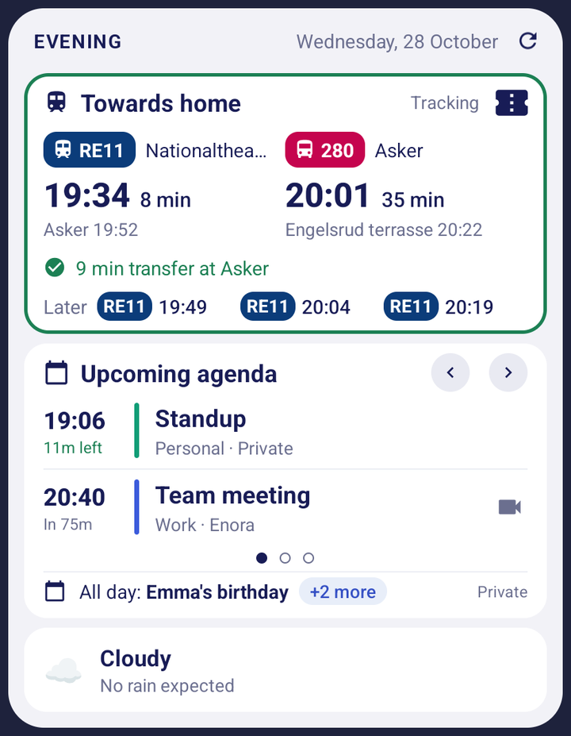
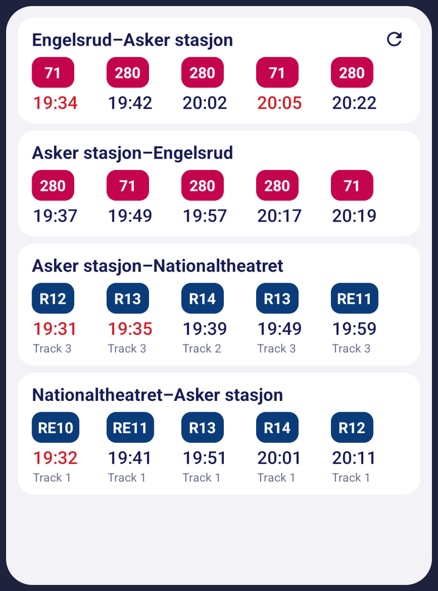
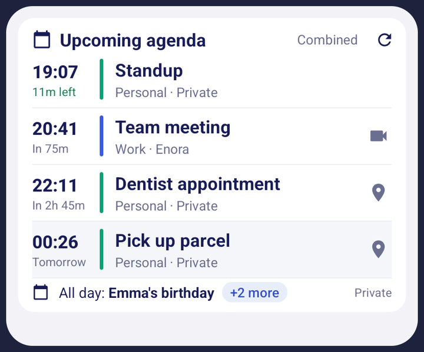
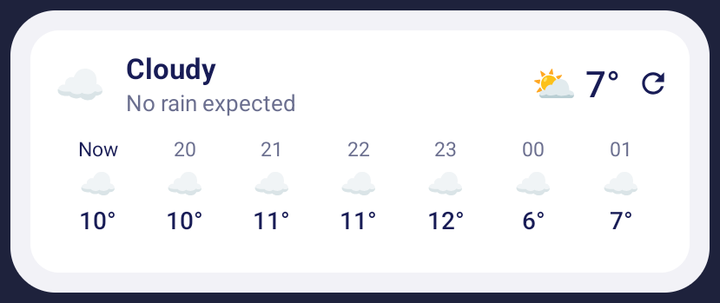
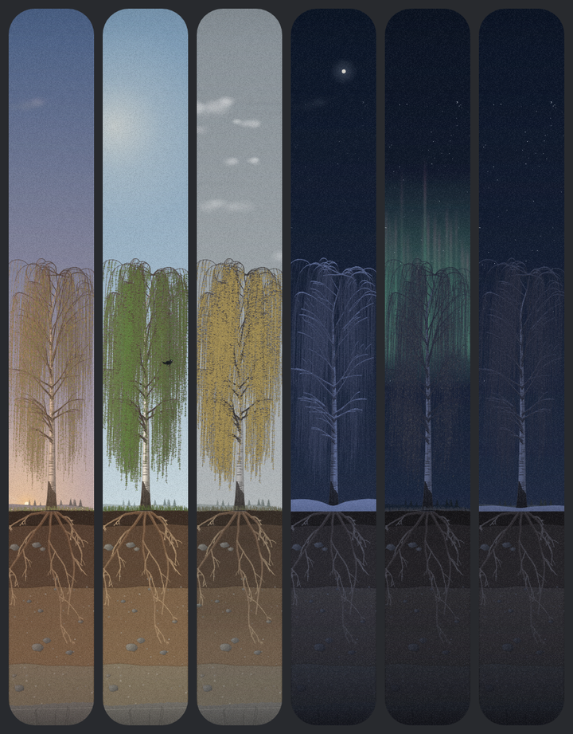
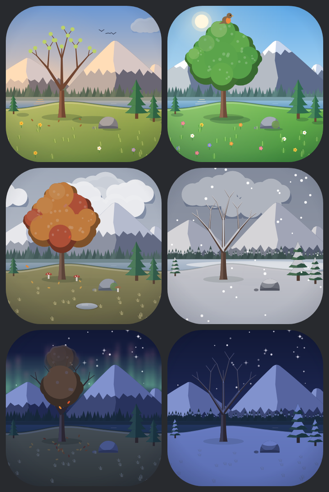

# Glance

Android home screen widgets for Norwegian public transport, your calendar and the weather.
The widgets refresh in the background and work while the app is closed.

- **Smart Glance** combines your commute, upcoming events and weather in one card.
- **Glance** shows bus and train departure boards, including delays, cancellations and platforms.
- **Glance commute** shows complete journeys in both directions, with transfers and journey tracking.
- **Glance agenda** shows calendar events from Nodecal, with meeting and location shortcuts.
- **Glance weather** shows current conditions and hourly forecasts from MET Norway.
- **Living Tree** is a narrow birch widget that follows the seasons, daylight and weather.
- **Tiny Living World** is a small lakeside diorama with seasonal changes and occasional wildlife.

## Screenshots


Android widget previews, captured at a few useful sizes. Calendar entries and weather use sample
data; the departure board shows a snapshot from Entur. The picture widgets show fixed seasonal
and night scenes. Open an image to see it at full size.

| Smart Glance | Departure board |
| --- | --- |
| [](screenshots/smart-glance.png) | [](screenshots/departure-board.png) |
| A tracked commute, calendar and weather together. | Four journey groups with the next departures. |

| Glance agenda | Glance weather |
| --- | --- |
| [](screenshots/agenda.png) | [](screenshots/weather.png) |
| Upcoming events and all-day reminders. | Current conditions and the hours ahead. |

| Living Tree | Tiny Living World |
| --- | --- |
| [](screenshots/living-tree.png) | [](screenshots/tiny-living-world.png) |
| The narrow birch widget through the seasons and night sky. | The lakeside diorama in six seasonal and night scenes. |

## Getting started

Install the Android APK, open Glance to configure your stops and integrations, then add a widget
from your launcher's widget picker. Resize it to fit your home screen. Tap a departure for journey
details, or use the refresh arrow for an immediate update.

Transport data comes directly from Entur and weather from MET Norway; neither needs an API key.
Calendar widgets require a Nodecal integration token, entered in Glance's settings.

## Development

The app uses React/Vite for configuration and journey details, with Capacitor and Kotlin for
native Android widgets. Requirements: Node 22.12+ or 24+, Android SDK 36 and JDK 21.

```sh
npm ci
npm ci --prefix apps/android
npm run dev
```

The browser previews the configuration interface; live departures and home screen widgets require
Android. Run `npm run android:debug` to build a debug APK. Checks: `npm run typecheck`,
`npm run lint` and `npm test`.

See [the development guide](DEVELOPMENT.md) for Android builds, releases, widget behaviour and
implementation details.

## License

Copyright (c) 2026 Lars Gjessing. All rights reserved. The source is public for inspection;
reuse requires prior written permission. See [LICENSE](LICENSE). Third-party components and
data retain their own licenses and terms.
